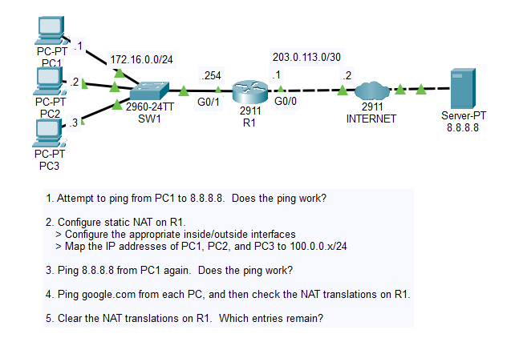
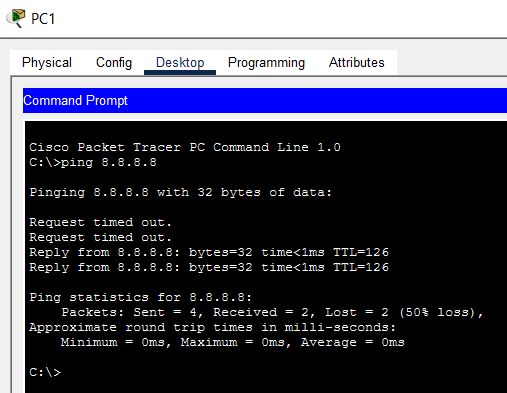

# Day 44 Lab

## Overview

Example configuration for static source NAT.



## Key Activities

- Configuring static source NAT. 

## Configurations

### Step 1

Attempt to ping from PC1 to 8.8.8.8. Does the ping work?<br>
The ping fails.

### Step 2

Configure static NAT on R1.
- Configure the appropriate inside/outside interfaces

```R1
R1(config)#interface gigabitEthernet 0/0
R1(config-if)#ip nat outside

R1(config)#interface gigabitEthernet 0/1
R1(config-if)#ip nat inside
```

- Map the IP addresses of PC1, PC2, and PC3 to 100.0.0.x/24

```R1
R1(config)#ip nat inside source static 172.16.0.1 100.0.0.1
R2(config)#ip nat inside source static 172.16.0.2 100.0.0.2
R3(config)#ip nat inside source static 172.16.0.3 100.0.0.3
```
```
R1#show ip nat translations 
Pro  Inside global     Inside local       Outside local      Outside global
---  100.0.0.1         172.16.0.1         ---                ---
---  100.0.0.2         172.16.0.2         ---                ---
---  100.0.0.3         172.16.0.3         ---                ---
```

```
R1#show ip nat statistics
Total translations: 3 (3 static, 0 dynamic, 0 extended)
Outside Interfaces: GigabitEthernet0/0
Inside Interfaces: GigabitEthernet0/1
Hits: 2  Misses: 4
Expired translations: 4
Dynamic mappings:
```

### Step 3

Ping 8.8.8.8 from PC1 again.  Does the ping work? <br>
Ping succeeds.



### Step 4

Ping google.com from each PC, and then check the NAT translations on R1.

```
R1#show ip nat translations 
Pro  Inside global     Inside local       Outside local      Outside global
icmp 100.0.0.1:5       172.16.0.1:5       172.217.175.238:5  172.217.175.238:5
icmp 100.0.0.1:6       172.16.0.1:6       172.217.175.238:6  172.217.175.238:6
icmp 100.0.0.1:7       172.16.0.1:7       172.217.175.238:7  172.217.175.238:7
icmp 100.0.0.1:8       172.16.0.1:8       172.217.175.238:8  172.217.175.238:8
icmp 100.0.0.2:1       172.16.0.2:1       172.217.175.238:1  172.217.175.238:1
icmp 100.0.0.2:2       172.16.0.2:2       172.217.175.238:2  172.217.175.238:2
icmp 100.0.0.2:3       172.16.0.2:3       172.217.175.238:3  172.217.175.238:3
icmp 100.0.0.2:4       172.16.0.2:4       172.217.175.238:4  172.217.175.238:4
icmp 100.0.0.3:1       172.16.0.3:1       172.217.175.238:1  172.217.175.238:1
icmp 100.0.0.3:2       172.16.0.3:2       172.217.175.238:2  172.217.175.238:2
icmp 100.0.0.3:3       172.16.0.3:3       172.217.175.238:3  172.217.175.238:3
icmp 100.0.0.3:4       172.16.0.3:4       172.217.175.238:4  172.217.175.238:4
---  100.0.0.1         172.16.0.1         ---                ---
---  100.0.0.2         172.16.0.2         ---                ---
---  100.0.0.3         172.16.0.3         ---                ---
udp 100.0.0.1:1025     172.16.0.1:1025    8.8.8.8:53         8.8.8.8:53
udp 100.0.0.2:1025     172.16.0.2:1025    8.8.8.8:53         8.8.8.8:53
udp 100.0.0.3:1025     172.16.0.3:1025    8.8.8.8:53         8.8.8.8:53
```

### Step 5

Clear the NAT translations on R1.  Which entries remain?

```
R1#clear ip nat translation *
R1#show ip nat translations 
Pro  Inside global     Inside local       Outside local      Outside global
---  100.0.0.1         172.16.0.1         ---                ---
---  100.0.0.2         172.16.0.2         ---                ---
---  100.0.0.3         172.16.0.3         ---                ---
```

Source: https://www.youtube.com/watch?v=vir6n_NVZFw&list=PLxbwE86jKRgMpuZuLBivzlM8s2Dk5lXBQ&index=90