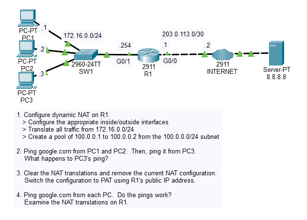

# Day 45 Lab

## Overview

Configure NAT & PAT.



## Key Activities

- Configured dynamic NAT.
- Changed the configuration to PAT.

## Configurations

### Step 1

Configure dynamic NAT on R1.
- Configure the appropriate inside/outside interfaces

```R1
R1(config)#interface gigabitEthernet 0/0
R1(config-if)#ip nat outside

R1(config)#interface gigabitEthernet 0/1
R1(config-if)#ip nat inside
```

- Translate all traffic from 172.16.0.0/24

```
R1(config)#access-list 1 permit 172.16.0.0 0.0.0.255
```

- Create a pool of 100.0.0.1 to 100.0.0.2 from the 100.0.0.0/24 subnet

```
ip nat pool POOL1 100.0.0.1 100.0.0.2 netmask 255.255.255.0
ip nat inside source list 1 pool POOL1
```

### Step 2

Ping google.com from PC1 and PC2.  Then, ping it from PC3.<br>
What happens to PC3's ping?
<br><br>
PC3's ping gets dropped due to insufficient IPs in the pool.

### Step 3

Clear the NAT translations and remove the current NAT configuration.

```
R1#clear ip nat translation *
```

Switch the configuration to PAT using R1's public IP address.

```
R1(config)#ip nat inside source list 1 interface GigabitEthernet0/0 overload
```

### Step 4

Ping google.com from each PC. Do the pings work?<br>
Examine the NAT translations on R1.

```
R1#show ip nat translations 
Pro  Inside global     Inside local       Outside local      Outside global
icmp 203.0.113.1:1024  172.16.0.3:5       172.217.175.238:5  172.217.175.238:1024
icmp 203.0.113.1:1025  172.16.0.3:6       172.217.175.238:6  172.217.175.238:1025
icmp 203.0.113.1:1026  172.16.0.3:7       172.217.175.238:7  172.217.175.238:1026
icmp 203.0.113.1:1027  172.16.0.3:8       172.217.175.238:8  172.217.175.238:1027
icmp 203.0.113.1:1028  172.16.0.1:5       172.217.175.238:5  172.217.175.238:1028
icmp 203.0.113.1:1029  172.16.0.1:6       172.217.175.238:6  172.217.175.238:1029
icmp 203.0.113.1:1030  172.16.0.1:7       172.217.175.238:7  172.217.175.238:1030
icmp 203.0.113.1:1031  172.16.0.1:8       172.217.175.238:8  172.217.175.238:1031
icmp 203.0.113.1:5     172.16.0.2:5       172.217.175.238:5  172.217.175.238:5
icmp 203.0.113.1:6     172.16.0.2:6       172.217.175.238:6  172.217.175.238:6
icmp 203.0.113.1:7     172.16.0.2:7       172.217.175.238:7  172.217.175.238:7
icmp 203.0.113.1:8     172.16.0.2:8       172.217.175.238:8  172.217.175.238:8
udp 203.0.113.1:1024   172.16.0.3:1026    8.8.8.8:53         8.8.8.8:53
udp 203.0.113.1:1025   172.16.0.1:1026    8.8.8.8:53         8.8.8.8:53
udp 203.0.113.1:1026   172.16.0.2:1026    8.8.8.8:53         8.8.8.8:53
```

Source: https://www.youtube.com/watch?v=vNs1xxiwGJs&list=PLxbwE86jKRgMpuZuLBivzlM8s2Dk5lXBQ&index=92