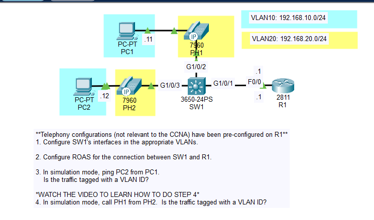
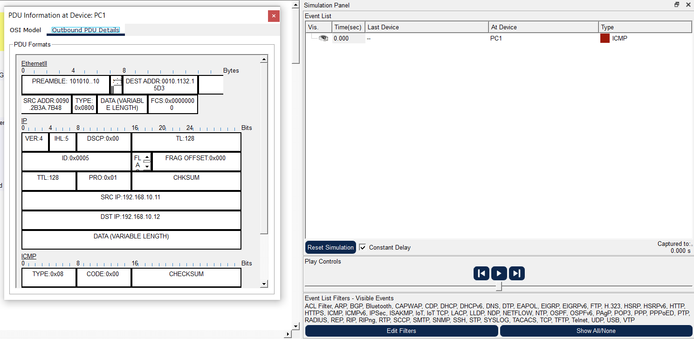
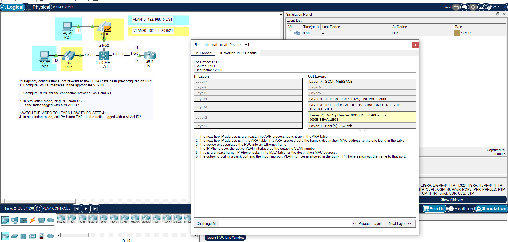
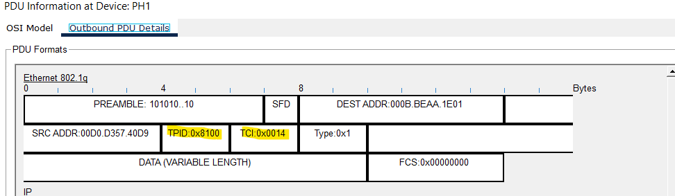

# Day 46 Lab

## Overview

Configured voice VLANs and monitored traffic.



## Key Activities

- Configured voice VLANs.
- Monitored PC traffic.
- Monitored phone traffic.

## Configurations

### Step 1

Configure SW1's interfaces in the appropriate VLANs.

```
SW(config)#interface range GigabitEthernet1/0/2 - 3
SW(config-if-range)#switchport access vlan 10
SW(config-if-range)#switchport voice vlan 20
```

### Step 2

Configure ROAS for the connection between SW1 and R1.

```
SW(config-if)#interface GigabitEthernet1/0/1
SW(config-if)#switchport trunk encapsulation dot1q
SW(config-if)#switchport trunk allowed vlan 10,20
```

```
R1(config-if)#interface FastEthernet0/0
R1(config-if)#no shutdown
```
```
R1(config-if)#interface FastEthernet0/0.10
R1(config-subif)#encapsulation dot1q 10
R1(config-subif)#ip address 192.168.10.1 255.255.255.0
```
```
R1(config-if)#interface FastEthernet0/0.20
R1(config-subif)#encapsulation dot1q 20
R1(config-subif)#ip address 192.168.20.1 255.255.255.0
```

### Step 3

In simulation mode, ping PC2 from PC1.<br>
Is the traffic tagged with a VLAN ID? (it isn't)



### Step 4

In simulation mode, call PH1 from PH2.  Is the traffic tagged with a VLAN ID? (it is)





Source: https://www.youtube.com/watch?v=kGX76QNIjsE&list=PLxbwE86jKRgMpuZuLBivzlM8s2Dk5lXBQ&index=94