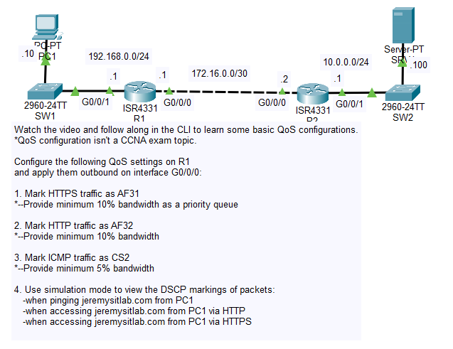
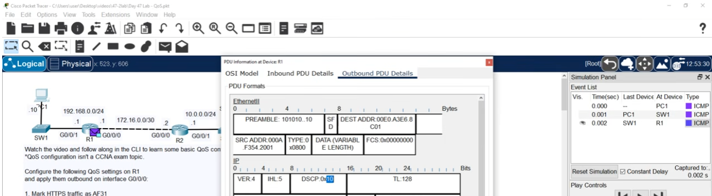
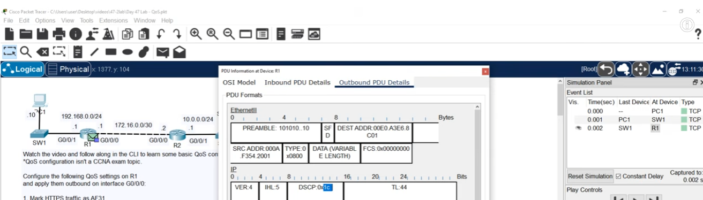
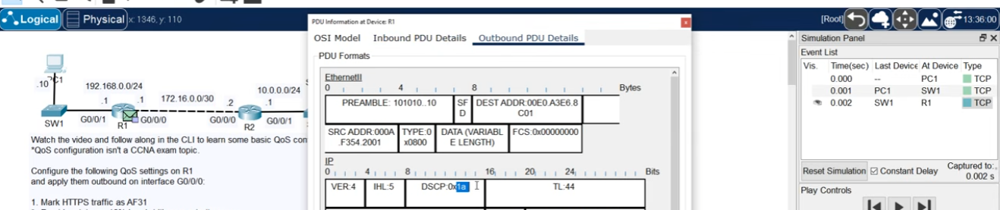

# Day 47 Lab

## Overview

Configured QoS.



## Key Activities

- Configured QoS.

## Configurations

### Step 1

Mark HTTPS traffic as AF31<br>
*--Provide minimum 10% bandwidth as a priority queue

```
R1(config)#policy-map G0/0/0_OUT
```
```
R1(config)#class-map match-all HTTPS_MAP
R1(config-cmap)#match protocol https
```
```
R1(config-pmap)#class HTTPS_MAP
R1(config-pmap-c)#priority percent 10
R1(config-pmap-c)#set ip dscp af31
```

### Step 2

Mark HTTP traffic as AF32<br>
*--Provide minimum 10% bandwidth

```
R1(config)#class-map match-all HTTP_MAP
R1(config-cmap)#match protocol http
```
```
R1(config-pmap)#class HTTP_MAP
R1(config-pmap-c)#bandwidth percent 10
R1(config-pmap-c)#set ip dscp af32
```

### Step 3

Mark ICMP traffic as CS2<br>
*--Provide minimum 5% bandwidth

```
R1(config)#class-map match-all ICMP_MAP
R1(config-cmap)#match protocol icmp
```
```
R1(config-pmap)#class ICMP_MAP
R1(config-pmap-c)#bandwidth percent 5
R1(config-pmap-c)#set ip dscp cs2
```

```
R1(config)#interface GigabitEthernet0/0/0
R1(config-if)#service-policy output G0/0/0_OUT
```

### Step 4

Use simulation mode to view the DSCP markings of packets:
- when pinging jeremysitlab.com from PC1

- when accessing jeremysitlab.com from PC1 via HTTP

- when accessing jeremysitlab.com from PC1 via HTTPS


Source: https://www.youtube.com/watch?v=63tD4t8189k&list=PLxbwE86jKRgMpuZuLBivzlM8s2Dk5lXBQ&index=96