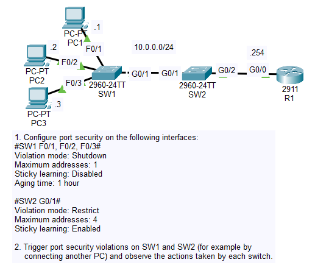

# Day 49 Lab

## Overview

Basic port security configurations.



## Key Activities

- Configured port security.
- Intentionally triggered it to observe behavior.

## Configurations

### Step 1

Configure port security on the following interfaces:<br>
#SW1 F0/1, F0/2, F0/3#<br>
Violation mode: Shutdown<br>
Maximum addresses: 1<br>
Sticky learning: Disabled<br>
Aging time: 1 hour<br><br>

```
SW1(config)#interface range FastEthernet0/1 - 3
SW1(config-if-range)#switchport mode access
SW1(config-if-range)#switchport port-security
SW1(config-if-range)#switchport port-security aging time 60
```

```
SW1#show port-security int f0/1
Port Security              : Enabled
Port Status                : Secure-up
Violation Mode             : Shutdown
Aging Time                 : 60 mins
Aging Type                 : Absolute
SecureStatic Address Aging : Disabled
Maximum MAC Addresses      : 1
Total MAC Addresses        : 0
Configured MAC Addresses   : 0
Sticky MAC Addresses       : 0
Last Source Address:Vlan   : 0000.0000.0000:0
Security Violation Count   : 0
```

#SW2 G0/1#<br>
Violation mode: Restrict<br>
Maximum addresses: 4<br>
Sticky learning: Enabled<br>

```
SW2(config)#interface GigabitEthernet0/1
SW2(config-if)#switchport mode access
SW2(config-if)#switchport port-security violation restrict
SW2(config-if)#switchport port-security mac-address sticky
SW2(config-if)#switchport port-security
```

```
SW2#sh port-security int g0/1
Port Security              : Enabled
Port Status                : Secure-up
Violation Mode             : Restrict
Aging Time                 : 0 mins
Aging Type                 : Absolute
SecureStatic Address Aging : Disabled
Maximum MAC Addresses      : 4
Total MAC Addresses        : 4
Configured MAC Addresses   : 0
Sticky MAC Addresses       : 4
Last Source Address:Vlan   : 0060.471C.1D19:1
Security Violation Count   : 0
```

### Step 2

Trigger port security violations on SW1 and SW2 (for example by connecting another PC) and observe the actions taken by each switch.<br><br>

Pinging from SW1 SVI to R1.

```
SW2#%PORT_SECURITY-2-PSECURE_VIOLATION: Security violation occurred, caused by MAC address 0060.7024.2366 on port GigabitEthernet0/1.
%PORT_SECURITY-2-PSECURE_VIOLATION: Security violation occurred, caused by MAC address 0060.7024.2366 on port GigabitEthernet0/1.
%PORT_SECURITY-2-PSECURE_VIOLATION: Security violation occurred, caused by MAC address 0060.7024.2366 on port GigabitEthernet0/1.
%PORT_SECURITY-2-PSECURE_VIOLATION: Security violation occurred, caused by MAC address 0060.7024.2366 on port GigabitEthernet0/1.
%PORT_SECURITY-2-PSECURE_VIOLATION: Security violation occurred, caused by MAC address 0060.7024.2366 on port GigabitEthernet0/1.
%PORT_SECURITY-2-PSECURE_VIOLATION: Security violation occurred, caused by MAC address 0060.7024.2366 on port GigabitEthernet0/1.
%PORT_SECURITY-2-PSECURE_VIOLATION: Security violation occurred, caused by MAC address 0060.7024.2366 on port GigabitEthernet0/1.
%PORT_SECURITY-2-PSECURE_VIOLATION: Security violation occurred, caused by MAC address 0060.7024.2366 on port GigabitEthernet0/1.
%PORT_SECURITY-2-PSECURE_VIOLATION: Security violation occurred, caused by MAC address 0060.7024.2366 on port GigabitEthernet0/1.
%PORT_SECURITY-2-PSECURE_VIOLATION: Security violation occurred, caused by MAC address 0060.7024.2366 on port GigabitEthernet0/1.

SW2#sh port-security int g0/1
Port Security              : Enabled
Port Status                : Secure-up
Violation Mode             : Restrict
Aging Time                 : 0 mins
Aging Type                 : Absolute
SecureStatic Address Aging : Disabled
Maximum MAC Addresses      : 4
Total MAC Addresses        : 4
Configured MAC Addresses   : 0
Sticky MAC Addresses       : 4
Last Source Address:Vlan   : 0060.7024.2366:1
Security Violation Count   : 10
```

Changing the MAC address of PC1 on f0/1.

```
%PM-4-ERR_DISABLE: psecure-violation error detected on Fa0/1, putting Fa0/1 in err-disable state.
%PORT_SECURITY-2-PSECURE_VIOLATION: Security violation occurred, caused by MAC address 0001.0001.00AE on port FastEthernet0/1.

SW1(config)#do sh port-sec int f0/1
Port Security              : Enabled
Port Status                : Secure-shutdown
Violation Mode             : Shutdown
Aging Time                 : 60 mins
Aging Type                 : Absolute
SecureStatic Address Aging : Disabled
Maximum MAC Addresses      : 1
Total MAC Addresses        : 0
Configured MAC Addresses   : 0
Sticky MAC Addresses       : 0
Last Source Address:Vlan   : 0001.0001.00AE:1
Security Violation Count   : 1
```

Source: https://www.youtube.com/watch?v=zZwhrxKeGj8&list=PLxbwE86jKRgMpuZuLBivzlM8s2Dk5lXBQ&index=100