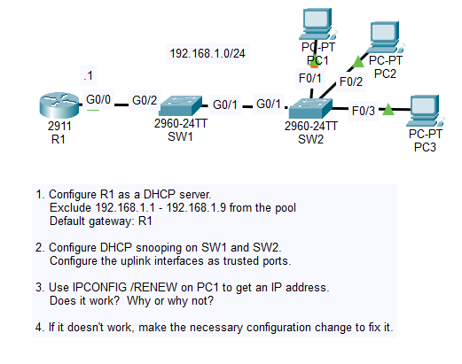
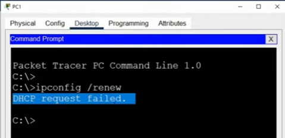
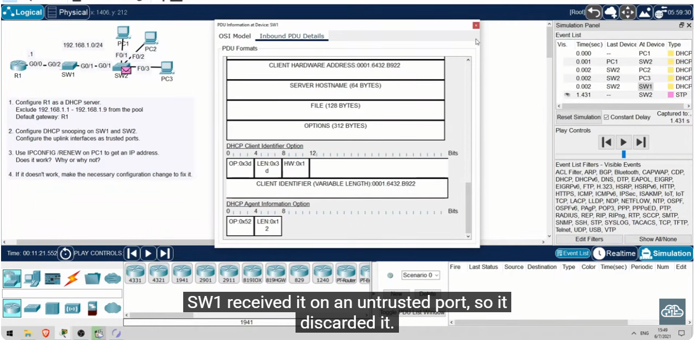

# Day 50 Lab

## Overview



## Key Activities

## Configurations

### Step 1

Configure R1 as a DHCP server.<br>
Exclude 192.168.1.1 - 192.168.1.9 from the pool<br>
Default gateway: R1

```
R1(config)#ip dhcp excluded-address 192.168.1.1 192.168.1.9
R1(config)#ip dhcp pool POOL1
R1(dhcp-config)#network 192.168.1.0 255.255.255.0
R1(dhcp-config)#default-router 192.168.1.1
```

### Step 2

Configure DHCP snooping on SW1 and SW2.<br>
Configure the uplink interfaces as trusted ports.

```
SW1(config)#ip dhcp snooping vlan1
SW1(config)#interface GigabitEthernet0/2
SW1(config-if)#ip dhcp snooping trust
```

```
SW2(config)#ip dhcp snooping vlan1
SW2(config)#interface GigabitEthernet0/1
SW2(config-if)#ip dhcp snooping trust
```

### Step 3

Use IPCONFIG /RENEW on PC1 to get an IP address.<br>
Does it work?  Why or why not?





### Step 4

If it doesn't work, make the necessary configuration change to fix it.

```
SW1(config)#no ip dhcp snooping information option
```

```
SW2(config)#no ip dhcp snooping information option
```

Source: https://www.youtube.com/watch?v=YMom_e545H4&list=PLxbwE86jKRgMpuZuLBivzlM8s2Dk5lXBQ&index=102