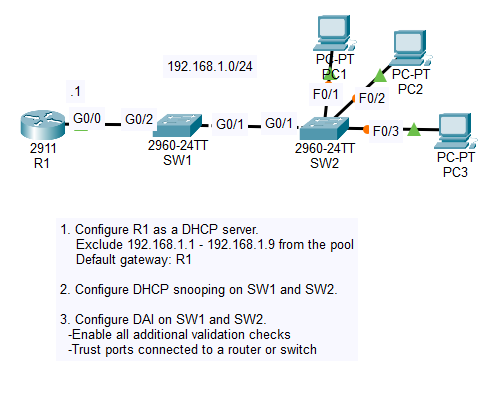

# Day 51 Lab

## Overview

In this lab, the main objective was to configure Dynamic ARP Inspection (DAI).



## Key Activities

- Configure DHCP
- Configure DHCP Snooping
- Configure DAI

## Configurations

### Step 1

Configure R1 as a DHCP server.<br>
Exclude 192.168.1.1 - 192.168.1.9 from the pool<br>
Default gateway: R1

```
R1(config)#ip dhcp excluded-address 192.168.1.1 192.168.1.9
R1(dhcp-config)#ip dhcp pool POOL1
R1(dhcp-config)#network 192.168.1.0 255.255.255.0
R1(dhcp-config)#default-router 192.168.1.1
```

### Step 2

Configure DHCP snooping on SW1 and SW2.

```
SW1(config)#ip dhcp snooping vlan 1
SW1(config)#no ip dhcp snooping information option
SW1(config)#interface GigabitEthernet0/2
SW1(config-if)#ip dhcp snooping trust
```
```
SW2(config)#ip dhcp snooping vlan 1
SW2(config)#no ip dhcp snooping information option
SW2(config)#interface GigabitEthernet0/1
SW2(config-if)#ip dhcp snooping trust
```

### Step 3

Configure DAI on SW1 and SW2.<br>
-Enable all additional validation checks<br>
-Trust ports connected to a router or switch

```
SW1(config)#ip arp inspection vlan 1
SW1(config)#ip arp inspection validate src-mac dst-mac ip
SW1(config)#interface range GigabitEthernet0/1 - 2
SW1(config-if-range)#ip arp inspection trust
```

```
SW2(config)#ip arp inspection vlan 1
SW2(config)#ip arp inspection validate src-mac dst-mac ip
SW2(config)#interface GigabitEthernet0/1
SW2(config-if)#ip arp inspection trust
```

Source: https://www.youtube.com/watch?v=oLF2mbmYMAk&list=PLxbwE86jKRgMpuZuLBivzlM8s2Dk5lXBQ&index=104