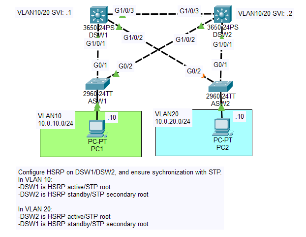

# Day 52 Lab

## Overview

Configure STP & HSRP sync.



## Configurations

Configure HSRP on DSW1/DSW2, and ensure sychronization with STP.<br>
In VLAN 10:<br>
-DSW1 is HSRP active/STP root<br>
-DSW2 is HSRP standby/STP secondary root<br>
<br>
In VLAN 20:<br>
-DSW2 is HSRP active/STP root<br>
-DSW1 is HSRP standby/STP secondary root

```
DSW1(config)#interface Vlan20
DSW1(config-if)#ip address 10.0.20.1 255.255.255.0
DSW1(config-if)#standby version 2
DSW1(config-if)#standby 20 ip 10.0.20.254
DSW1(config-if)#standby 20 priority 95
DSW1(config-if)#standby 20 preempt
```
```
DSW1(config)#interface Vlan10
DSW1(config-if)#ip address 10.0.10.1 255.255.255.0
DSW1(config-if)#standby version 2
DSW1(config-if)#standby 10 ip 10.0.10.254
DSW1(config-if)#standby 10 priority 105
DSW1(config-if)#standby 10 preempt
```

```
DSW2(config)#interface Vlan10
DSW2(config-if)#ip address 10.0.10.2 255.255.255.0
DSW2(config-if)#standby version 2
DSW2(config-if)#standby 10 ip 10.0.10.254
DSW2(config-if)#standby 10 priority 95
DSW2(config-if)#standby 10 preempt
```
```
DSW2(config)#interface Vlan20
DSW2(config-if)#ip address 10.0.20.2 255.255.255.0
DSW2(config-if)#standby version 2
DSW2(config-if)#standby 20 ip 10.0.20.254
DSW2(config-if)#standby 20 priority 105
DSW2(config-if)#standby 20 preempt
```
```
DSW1#show standby brief 
                     P indicates configured to preempt.
                     |
Interface   Grp  Pri P State    Active          Standby         Virtual IP
Vl10        10   105 P Active   local           10.0.10.2       10.0.10.254    
Vl20        20   95  P Standby  10.0.20.2       local           10.0.20.254    
```
```
DSW2#show standby brief
                     P indicates configured to preempt.
                     |
Interface   Grp  Pri P State    Active          Standby         Virtual IP
Vl10        10   95  P Standby  10.0.10.1       local           10.0.10.254    
Vl20        20   105 P Active   local           unknown         10.0.20.254 
```
Source: https://www.youtube.com/watch?v=BgIEhyoETgU&list=PLxbwE86jKRgMpuZuLBivzlM8s2Dk5lXBQ&index=107