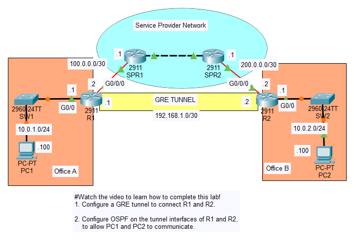

# Day 53 Lab

## Overview

Configure a GRE tunnel and OSPF.



## Configurations

### Step 1

Configure a GRE tunnel to connect R1 and R2.

```
R1(config)#interface Tunnel0
R1(config-if)#ip address 192.168.1.1 255.255.255.252
R1(config-if)#mtu 1476
R1(config-if)#tunnel source GigabitEthernet0/0/0
R1(config-if)#tunnel destination 200.0.0.2
```

```
R2(config)#interface Tunnel0
R2(config-if)#ip address 192.168.1.2 255.255.255.252
R2(config-if)#mtu 1476
R2(config-if)#tunnel source GigabitEthernet0/0/0
R2(config-if)#tunnel destination 100.0.0.2
```

```
R2(config)#ip route 0.0.0.0 0.0.0.0 100.0.0.1 
```

```
R2(config)#ip route 0.0.0.0 0.0.0.0 200.0.0.1 
```

### Step 2

Configure OSPF on the tunnel interfaces of R1 and R2, to allow PC1 and PC2 to communicate.

```
R1(config)#router ospf 1
R1(config-router)#passive-interface GigabitEthernet0/0
R1(config-router)#network 192.168.1.1 0.0.0.0 area 0
R1(config-router)#network 10.0.1.1 0.0.0.0 area 0
```

```
R2(config)#router ospf 1
R2(config-router)#passive-interface GigabitEthernet0/0
R2(config-router)#network 192.168.1.2 0.0.0.0 area 0
R2(config-router)#network 10.0.2.1 0.0.0.0 area 0
```

```
R1#show ip route
Codes: L - local, C - connected, S - static, R - RIP, M - mobile, B - BGP
       D - EIGRP, EX - EIGRP external, O - OSPF, IA - OSPF inter area
       N1 - OSPF NSSA external type 1, N2 - OSPF NSSA external type 2
       E1 - OSPF external type 1, E2 - OSPF external type 2, E - EGP
       i - IS-IS, L1 - IS-IS level-1, L2 - IS-IS level-2, ia - IS-IS inter area
       * - candidate default, U - per-user static route, o - ODR
       P - periodic downloaded static route

Gateway of last resort is 100.0.0.1 to network 0.0.0.0

     10.0.0.0/8 is variably subnetted, 3 subnets, 2 masks
C       10.0.1.0/24 is directly connected, GigabitEthernet0/0
L       10.0.1.1/32 is directly connected, GigabitEthernet0/0
O       10.0.2.0/24 [110/1001] via 192.168.1.2, 00:08:32, Tunnel0
     100.0.0.0/8 is variably subnetted, 2 subnets, 2 masks
C       100.0.0.0/30 is directly connected, GigabitEthernet0/0/0
L       100.0.0.2/32 is directly connected, GigabitEthernet0/0/0
     192.168.1.0/24 is variably subnetted, 2 subnets, 2 masks
C       192.168.1.0/30 is directly connected, Tunnel0
L       192.168.1.1/32 is directly connected, Tunnel0
S*   0.0.0.0/0 [1/0] via 100.0.0.1
```

```
R2#show ip route
Codes: L - local, C - connected, S - static, R - RIP, M - mobile, B - BGP
       D - EIGRP, EX - EIGRP external, O - OSPF, IA - OSPF inter area
       N1 - OSPF NSSA external type 1, N2 - OSPF NSSA external type 2
       E1 - OSPF external type 1, E2 - OSPF external type 2, E - EGP
       i - IS-IS, L1 - IS-IS level-1, L2 - IS-IS level-2, ia - IS-IS inter area
       * - candidate default, U - per-user static route, o - ODR
       P - periodic downloaded static route

Gateway of last resort is 200.0.0.1 to network 0.0.0.0

     10.0.0.0/8 is variably subnetted, 3 subnets, 2 masks
O       10.0.1.0/24 [110/1001] via 192.168.1.1, 00:08:01, Tunnel0
C       10.0.2.0/24 is directly connected, GigabitEthernet0/0
L       10.0.2.1/32 is directly connected, GigabitEthernet0/0
     192.168.1.0/24 is variably subnetted, 2 subnets, 2 masks
C       192.168.1.0/30 is directly connected, Tunnel0
L       192.168.1.2/32 is directly connected, Tunnel0
     200.0.0.0/24 is variably subnetted, 2 subnets, 2 masks
C       200.0.0.0/30 is directly connected, GigabitEthernet0/0/0
L       200.0.0.2/32 is directly connected, GigabitEthernet0/0/0
S*   0.0.0.0/0 [1/0] via 200.0.0.1
```

Source: https://www.youtube.com/watch?v=_MMuU5viinM&list=PLxbwE86jKRgMpuZuLBivzlM8s2Dk5lXBQ&index=108