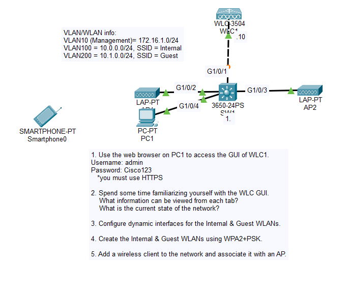
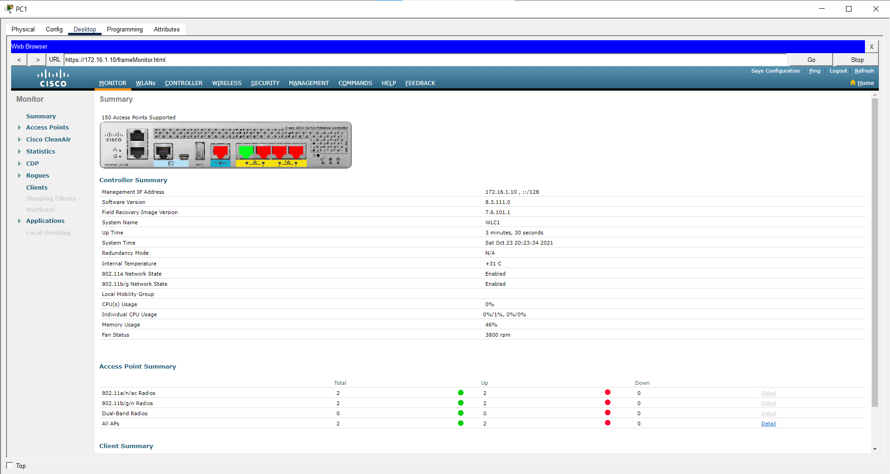
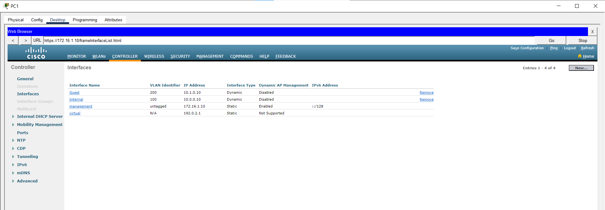
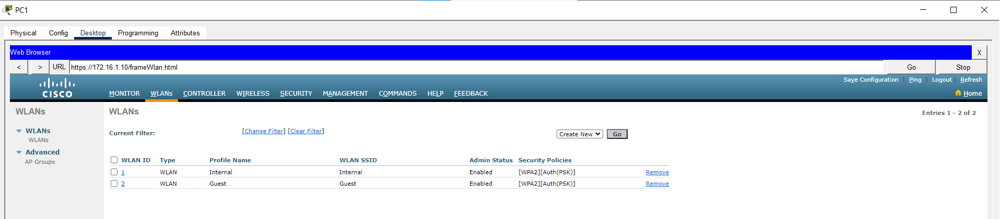
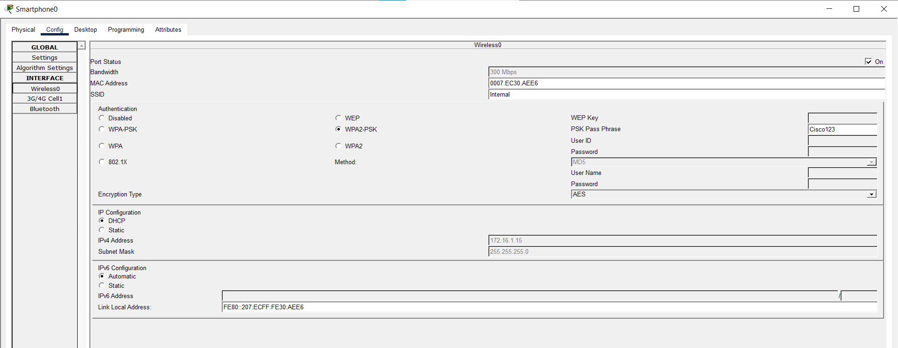

# Day 58 Lab

## Overview

Basic WLAN config via GUI.

## Key Activities

## Configurations

### Step 1

Use the web browser on PC1 to access the GUI of WLC1. 
Username: admin 
Password: Cisco123 
   *you must use HTTPS

### Step 2

Spend some time familiarizing yourself with the WLC GUI. 
    What information can be viewed from each tab? 
    What is the current state of the network?

### Step 3

Configure dynamic interfaces for the Internal & Guest WLANs.

### Step 4

Create the Internal & Guest WLANs using WPA2+PSK.

### Step 5

Add a wireless client to the network and associate it with an AP.

Source: https://www.youtube.com/watch?v=Il8ev78fcqw&list=PLxbwE86jKRgMpuZuLBivzlM8s2Dk5lXBQ&index=117